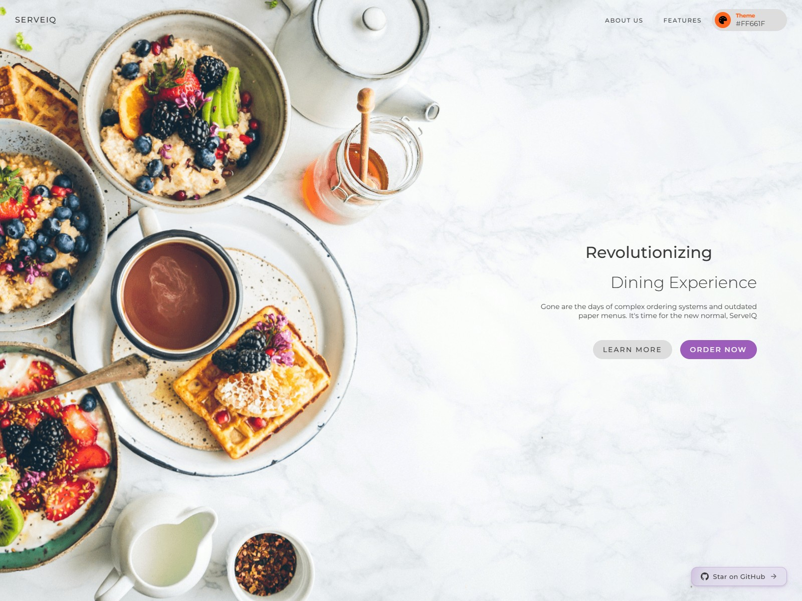
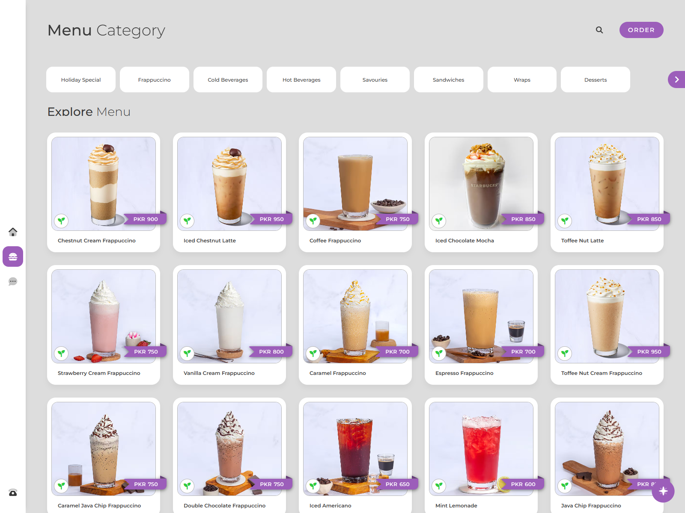
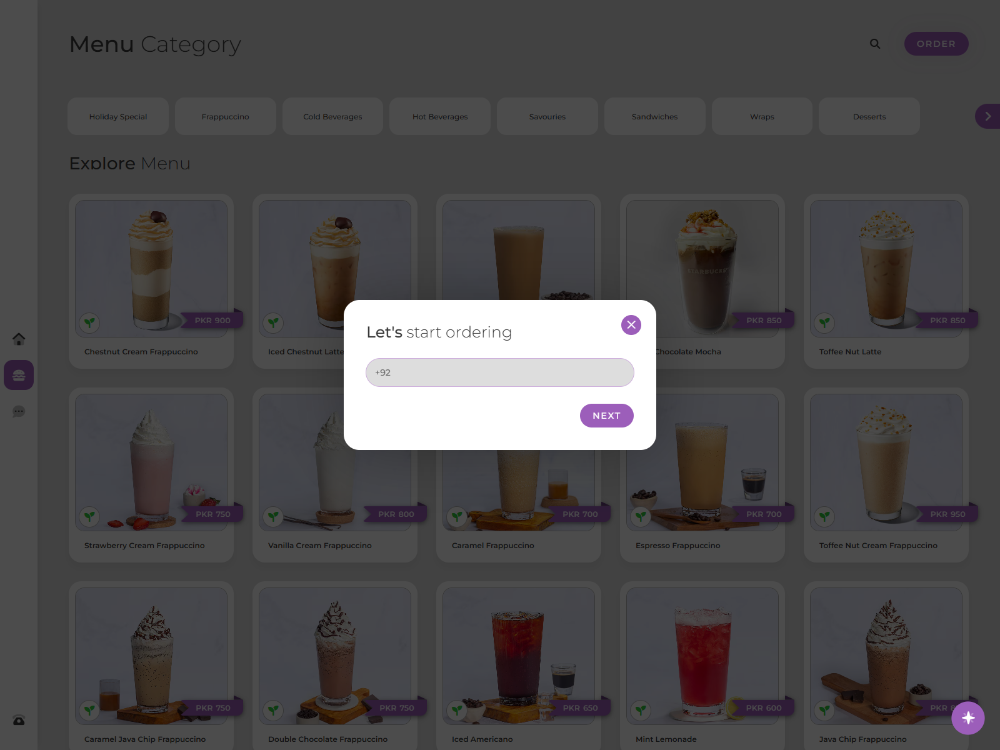
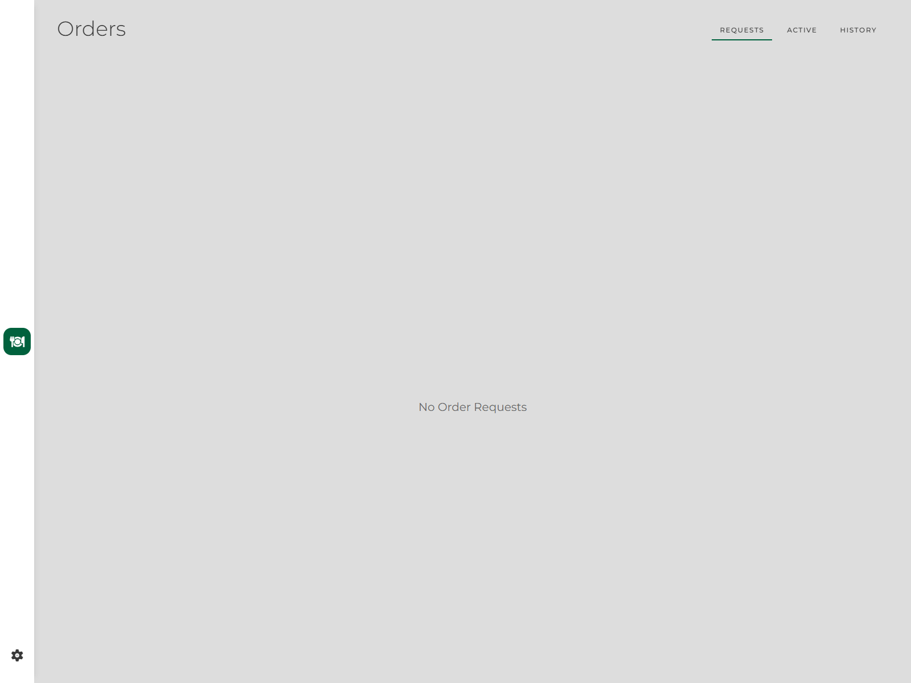
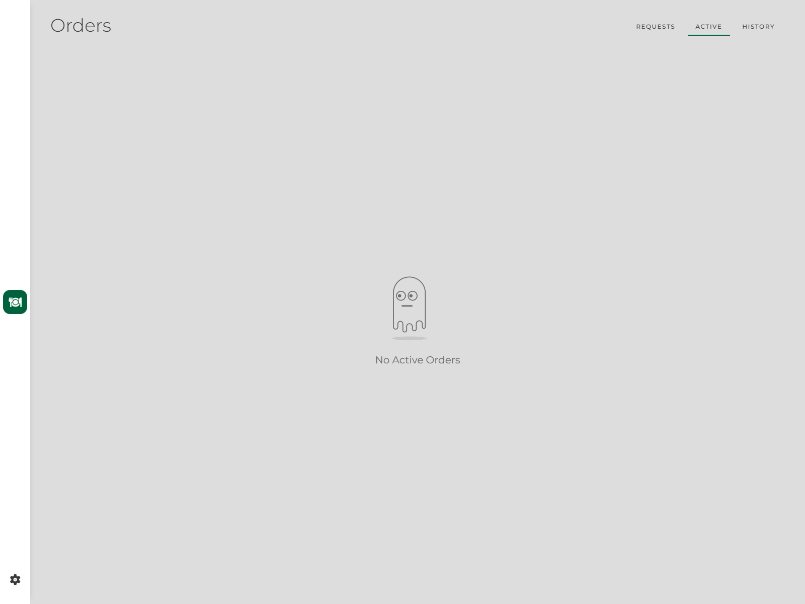

# ServeIQ

ServeIQ is a full-stack restaurant ordering and management platform. Customers
scan a table QR code, browse a digital menu, chat with an AI assistant, and
place orders without downloading an app. Restaurant teams manage orders,
kitchen operations, menus, tables, and settings from authenticated dashboards.

## Features

- QR-code menu access for restaurant tables
- Contactless cart and order placement
- AI assistant named Jarvis for menu questions and recommendations
- Admin dashboard for orders, menus, tables, themes, and account settings
- Kitchen dashboard for processing active orders
- Responsive interface with light and dark themes
- Multi-restaurant data model backed by MongoDB

## Tech stack

- Next.js 16 and React 19
- TypeScript and SCSS
- MongoDB with Mongoose
- NextAuth.js credentials authentication
- Vercel AI SDK with OpenAI-compatible providers
- pnpm

## Getting started

### Prerequisites

- Node.js `20.9.0` (see [`.nvmrc`](./.nvmrc))
- pnpm
- MongoDB
- API keys for any AI providers you want to enable

### Install

```bash
pnpm install
```

### Configure environment variables

Create `.env.local` in the project root:

```dotenv
MONGODB_URI=mongodb://localhost:27017/serveiq
NEXTAUTH_SECRET=replace-with-a-long-random-secret
NEXT_PUBLIC_SITE_URL=http://localhost:3000

# Add the providers you want to use.
AI_GROQ_KEY=
AI_CEREBRAS_KEY=
AI_GOOGLE_KEY=
AI_SILICONFLOW_KEY=
```

`MONGODB_URI` and `NEXTAUTH_SECRET` are required. `NEXT_PUBLIC_SITE_URL`
defaults to a placeholder URL if omitted, so set it for correct metadata,
robots, and sitemap links.

### Run in development

For local development without Doppler:

```bash
pnpm play
```

The app is available at [http://localhost:3000](http://localhost:3000).

If your environment uses Doppler, use the configured script instead:

```bash
pnpm dev
```

### Build for production

```bash
pnpm build
pnpm start
```

Run the configured checks with:

```bash
pnpm check
```

## Using ServeIQ

### Customer experience

1. Open `/scan` to scan a table QR code, or open a restaurant menu directly:
   `/<restaurant>?table=1`.
2. Browse the menu, add items to the cart, and place an order.
3. Enter the requested customer details when prompted.

### Restaurant experience

1. Open the home page and sign in with an administrator account.
2. Use `/dashboard` to manage orders, menus, themes, and settings.
3. Use `/kitchen` to view and process active kitchen orders.

## Screenshots

<p align="center">
  
  
</p>
<p align="center">
  
  
</p>
<p align="center">
  
  
</p>

## Project structure

```text
src/app/        Pages, dashboards, API routes, and customer flows
src/components/ Shared React components
src/utils/      Database, authentication, AI, SEO, and helper modules
public/         Images and other static assets
```

## License

No license has been specified yet. Add a `LICENSE` file before distributing
ServeIQ as open-source software.
